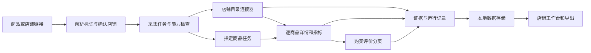

# 五平台指定店铺公开商品数据采集：功能可行性与工具方案

整理日期：2026-10-18。资料与线上实测主要发生于 2026-10-11—12；本次整理没有重新请求五个平台，也没有试用收费 API。接口、商品状态和供应商能力可能已变化，应按报告中的验收条件复测。

本报告覆盖淘宝、京东、拼多多、闲鱼和抖音商城，目标是从指定店铺或商品分享链接出发，取得商品详情、所属店铺、全店商品列表、销量、好评率及购买评价。它汇总 GitHub 项目调研、五条链接的浏览器实测、Catbus 源码审查、京东/抖音登录实测，以及已授权的抖音图片字段修复。完整采集工具仍处于规划阶段。

## 1. 结论与功能边界

可以规划一个按店铺管理的商品监测工作台，但现有证据不足以承诺五个平台的全店、全指标、全量评论采集。应先推出已经验证的单品能力，再逐个平台证明店铺目录和指标来源。

目前最有价值的可复用能力是 **Catbus 的抖音商品评价分页**：目标商品手动两页取得 10+8 条，自动翻页取得同一组 18 个唯一评价 ID。京东取得 3 条首批评价，尚无完整分页能力。抖音详情的图片字段类型错误已局部修复，目标命令输出 20 张图片；它的当前返回仍缺标题、价格和店铺字段，不能称为完整详情接口已跑通。

抖音商品统计接口返回 `GoodRatio=88.88888888888889`，可以记录为**这件商品在当次接口响应中的好评率 88.89%**。瀚惠数码专营店的名称和数字店铺 ID 已确认；店铺页及口碑分数可取得，但全店商品请求返回业务错误 `100111`。实时销量、全店好评率和完整店铺目录仍未取得。

建议采用“店铺/任务管理 + 可替换的平台连接器 + 带口径的数据与证据层”。Catbus 是局部连接器候选，供应商 API 和浏览器读取是独立候选来源；不能将多个项目 README 中的能力合并成已经可用的统一工具。

## 2. 证据等级及容易混淆的指标

| 证据等级 | 本报告中的含义 | 可支持的结论 |
| --- | --- | --- |
| 线上实测 | 普通页面访问、页面正常请求，或现有 Catbus/API 的实际返回 | 该日期、该商品、该账号条件下取得的字段与分页 |
| 源码核验 | 核对处理器、参数、解析、归一化、分页和 fixture | 实现是否存在、如何工作；不能证明平台当前连通 |
| 文档声明 | 作者或供应商的说明、接口文档及样例 | 候选能力；必须在目标商品/店铺上试调 |
| 方案建议 | 根据上述证据提出的结构与验收步骤 | 待实施的设计，不是交付功能 |
| 未取得/未验证 | 缺少成功响应、字段或完整分页证据 | 保留空值和失败原因，不能填 0 或判定永久不支持 |

| 名称 | 需要明确的口径 | 不可替代它的值 |
| --- | --- | --- |
| 商品销量 | 本店本商品还是跨店同款；累计还是某周期；精确值还是展示区间 | 评论量、浏览量、想要量、销量排序、分享 URL 快照 |
| 商品好评率 | 统计对象、分母、默认/空文字评价是否计入、接口返回时间 | 店铺评分、单条五星评价、少量评论的情感分析结果 |
| 店铺好评率 | 平台对店铺/卖家的整体交易评价统计 | 单件商品的 GoodRatio、店铺口碑 4.6 分 |
| 商品购买评价 | 归属商品、购买 SKU、评分、追评及分页范围 | 视频评论、商品问答、私信、店铺评价 |
| 全店商品列表 | 指定店铺的实际商品记录、有效分页终点及范围 | 关键词搜索、推荐列表、直播间商品、页面“共 N 件”提示 |

所有平台 ID 应按字符串保存。`product_id`、`promotion_id`、`shop_id`、`sec_shop_id`、`seller_id` 分开建字段；本次某接口接受加密标识，不能推导为所有接口都接受它。

## 3. 五条用户链接的累计实测结果

以下合并各阶段结果，以较晚的成功实测修正较早的“未取得”，保留不同来源的边界。详细摘录见 [证据包](ecommerce/evidence.json)。

| 平台及目标 | 商品详情 | 所属店铺 | 全店列表 | 当前销量 | 好评率 | 评论及分页 |
| --- | --- | --- | --- | --- | --- | --- |
| 淘宝：教程 U 盘分享链接 | 短链被浏览器站点安全策略阻止；标题仅来自分享文案 | 未取得 | 未验证 | 未取得 | 未取得 | 未取得 |
| 京东：SKU `100274600522` | 浏览器取得截断标题与服务提示；Catbus 登录后详情 HTTP 403 | 浏览器确认猛玛京东自营旗舰店，`1000418405` | 店铺入口 403；“63 件”仅为当时数量提示 | 未取得 | 未取得 | Catbus 取得 3 条首批评价；无第二页证明 |
| 拼多多：商品 `938660939400` | 短链解析后进入登录页，未取得商品正文 | 未取得 | 未验证 | 未取得 | 未取得 | 未取得 |
| 闲鱼：WorkBuddy 课程分享链接 | 短链被浏览器站点安全策略阻止；标题仅来自分享文案 | 未取得卖家 ID | 未验证 | 未取得 | 未取得卖家好评率 | 未取得交易评价 |
| 抖音：商品 `3835787882229006441` | 浏览器取得标题/部分参数；修复后的 Catbus 输出 20 张图和原始规格，标准标题/价格/商家为空 | 瀚惠数码专营店；`shop_id=299558479`，`sec_shop_id=kEwwCQXz` | 网页壳可打开；列表跨域失败，独立首屏请求业务错误 `100111`，无条目 | 未取得；分享快照 585 不计作当前销量 | 商品接口返回 88.89%；全店好评率未取得 | 手动 10+8 条、自动 18 条，唯一 ID 一致，末页结束；7 条有文字、11 条文字为空 |

原始分享入口如下；这些是历史测试输入，不保证目前仍有效：

| 平台 | 原始链接 | 已确认的规范标识或入口 |
| --- | --- | --- |
| 淘宝 | [e.tb.cn 分享页](https://e.tb.cn/h.j0S7na9jx9dV4qk?tk=vmaATrEhJwZ) | 商品/卖家 ID 尚未确认 |
| 京东 | [3.cn 分享页](https://3.cn/36JOj-uf?jkl=@J7tDF4nvOe4@) | SKU `100274600522`；店铺 `1000418405` |
| 拼多多 | [商品分享页](https://mobile.yangkeduo.com/goods1.html?ps=2qi2Tiwdot) | 商品 `938660939400` |
| 闲鱼 | [m.tb.cn 分享页](https://m.tb.cn/h.jZ0e3vV?tk=x33mTrEimf8) | 商品/卖家 ID 尚未确认 |
| 抖音 | [v.douyin.com 分享页](https://v.douyin.com/-UL3moj8ohY/) | [商品页](https://haohuo.jinritemai.com/ecommerce/trade/detail/index.html?id=3835787882229006441)；[店铺页](https://haohuo.jinritemai.com/views/shop/index?id=kEwwCQXz&url_maker=shop_sdk) |

淘宝、闲鱼的访问阻断发生在浏览器安全策略层，不构成商品失效或平台没有采集能力的证据。拼多多缺少已登录商品读取结果。京东和抖音登录成功也只代表会话有效，不能自动保证详情与店铺接口可用。

## 4. GitHub 与商业接口候选分析

下表是 10 月 11 日研究范围中的源码/文档判断。除 Catbus 外，没有在这五条用户链接上运行这些候选项目；本次整理未刷新其维护状态、价格或供应商服务能力。参考链接与定位见 [参考资料索引](ecommerce/references.md)。

| 候选工具 | 源码/文档中的适用能力 | 指定店铺与指标的关键缺口 | 建议用途 |
| --- | --- | --- | --- |
| [cv-cat/catbus](https://github.com/cv-cat/catbus) | 统一 CLI、会话、JSON 输出、部分商品详情；京东首批评价、抖音电商评价分页 | 五平台全店目录缺失；淘宝商品/评价未实现；拼多多无模块；指标标准模型不足 | 先接入已验证的抖音单品评价，保留局部详情能力 |
| [Runjeo/ecom-scraper](https://github.com/Runjeo/ecom-scraper) | 平台适配器及 Product/Shop/SKU 结构；当时目录主要为 JD、Taobao、Amazon | README 的平台范围不能替代实现核验；存在 fixture/已有 JSON 解析路径，未证明 PDD/抖音全店线上接入 | 数据模型、适配器分层参考 |
| [hairconker/Product-Crawling](https://github.com/hairconker/Product-Crawling) | Playwright、登录 Cookie、京东/淘宝/闲鱼商品搜索 | 当前研究版本主要按关键词搜索，已移除拼多多；指定店铺全遍历未证明 | 商品发现、浏览器读取参考 |
| [zhangjiancong/MarketSpider](https://github.com/zhangjiancong/MarketSpider) | 商品搜索/采集流程 | 未在目标店铺证明全目录、销量口径及完整评论 | 辅助候选，不作为全店能力承诺 |
| [Usagi-org/ai-goofish-monitor](https://github.com/Usagi-org/ai-goofish-monitor) | 闲鱼监测、卖家商品/评价读取、任务与存储 | 仅覆盖闲鱼；从采集评价计算的比例需与平台卖家统计分开 | 闲鱼连接器与监测工作流参考 |
| [DoLovya/pyxianyu](https://github.com/DoLovya/pyxianyu) | 按 userId 的 get_user_items/get_all_user_items 和 nextPage 处理 | 本样本尚无 itemId/userId，未实测末页、状态范围及交易评价 | 闲鱼指定卖家目录优先验证候选 |
| [superboyyy/xianyu_spider](https://github.com/superboyyy/xianyu_spider) | 闲鱼相关采集实现 | 会话依赖，未在用户样本复现五项指标 | 闲鱼补充参考 |
| [hengshen2233/CommentAnalysis](https://github.com/hengshen2233/CommentAnalysis) | DrissionPage 评论采集与处理代码 | PDD 路径采集店铺评价；淘宝把用户等级用作评分，指标语义需纠正 | 评论处理参考，不能原样作为指标实现 |
| [NanmiCoder/MediaCrawler](https://github.com/NanmiCoder/MediaCrawler) | 内容平台采集与评论流程 | 本研究未发现能完成本需求的商城全店商品链路；视频评论不能替代购买评价 | 内容评论的工程参考 |
| [TikHub SDK](https://github.com/TikHub/TikHub-API-Python-SDK) | 文档列出抖音商品详情、评价列表、评价统计、SKU 等资源 | 开源 SDK 调用商业服务，需要凭证/配额；目标店铺及全目录未试调 | 商品数据供应商候选 |
| [Just One API SDK](https://github.com/justoneapi-labs/justoneapi-python) | 文档覆盖淘宝/京东/抖音的详情、评价、店铺列表，以及闲鱼搜索/详情 | SDK 免费开源不等于数据服务免费；ID、分页、统计字段及目标样本未调用验证 | 店铺列表和完整评论的优先试用候选 |
| [Onebound PDD 详情](https://open.onebound.cn/help/api/pinduoduo.item_get_app-3.0.0-7.0.html) | 商品详情原数据、销量展示及部分评价样例 | 未证明当前目标商品、全店目录与评论分页；未进行付费调用 | 拼多多单品详情候选 |
| 历史 PDD 爬虫/SDK | anti_content、移动端接口或历史 mall 商品接口的实现片段 | [SZFsir/pddSpider](https://github.com/SZFsir/pddSpider) 记录签名难题；[DDK_SDK 历史文件](https://github.com/makelove/DDK_SDK/blob/master/测试/下线/查询店铺商品1.py) 标记旧店铺接口下线 | 解释历史方案限制，不作为当前可用路径 |

供应商端点值得试用，但以下内容仍属于文档声明：

| 资源 | 文档要求/样例字段 | 本需求中的试用输入与未知项 |
| --- | --- | --- |
| [淘宝店铺列表 V4](https://docs.justoneapi.com/zh/api/taobao-and-tmall/shop-product-list-v4) | sellerId、page | 先补齐目标商品及 sellerId，再验证全店分页 |
| [淘宝销量 V1](https://docs.justoneapi.com/zh/api/taobao-and-tmall/product-sales-v1) | 研究时供应商标为过期 | 不作为稳定 30 天销量方案 |
| [京东店铺列表 V1](https://docs.justoneapi.com/zh/api/jdcom/shop-product-list-v1) | shopId、page | `1000418405`；末页、SKU/SPU 范围待验证 |
| [京东评价 V2 样例](https://github.com/justoneapi-labs/justoneapi-python/blob/main/docs/api-examples/getApiJdGetItemCommentsV2.json) | 评论与 GoodRate/GoodRateShow | SKU `100274600522`；是否同款合并、实际分母待验证 |
| [抖音店铺列表 V1](https://docs.justoneapi.com/zh/api/douyin-e-commerce/shop-product-list-v1) | shopId、page | 数字 ID `299558479` 与加密 ID `kEwwCQXz` 分别记录；供应商接受哪一种待验证 |
| [抖音商品评价 V1](https://docs.justoneapi.com/zh/api/douyin-e-commerce/item-comments-v1) | itemId、page | 商品 `3835787882229006441`；可与 Catbus 的历史 18 条结果比对 |
| [抖音详情 V2 样例](https://github.com/justoneapi-labs/justoneapi-python/blob/main/docs/api-examples/getApiDouyinEcGetItemDetailV2.json) | total_sales、good_ratio、shop_id | 字段存在于样例，不代表已取得这件商品的实时销量 |

## 5. Catbus 的实现范围与实测差异

源码基线为 `e637cb43078cbe776313ac3500cf0646c2a7b843`，版本 0.1.0。研究保留了 45 份定向源码/文档快照及 7 份 fixture 摘录，核对范围包含注册表、链接解析、请求构造、归一化、分页及在线测试跳过条件。固定版本来源见 [源码索引](ecommerce/references.md#catbus-固定提交源码与文档)。

| 平台 | 基线源码确认 | 目标样本实测与修正 |
| --- | --- | --- |
| 淘宝 | item get/search、comment list、user items 为规划，无处理器；user get 部分解析商品 HTML 中卖家信息 | 未运行目标商品；不能因主机匹配短链规则认定解析成功 |
| 京东 | 商品详情有实现；评价只请求一次；sort=sales 仅控制搜索排序 | 登录后详情 403；评价成功 3 条，只是首批；店名来自浏览器 |
| 拼多多 | 基线无平台模块 | 无 Catbus 运行路径 |
| 闲鱼 | item get 可从 itemDO/sellerDO 归一化详情；卖家商品遍历为规划，无交易评价列表 | 目标分享页未访问成功；browseCnt/wantCnt/soldPrice 不作销量 |
| 抖音 | product get 与 comment list --product 是电商；item/user items 是内容；live products 是直播间商品 | 单品评价分页成功；图片类型修复后详情部分成功；全店能力仍缺失 |

### 5.1 京东：登录有效，详情仍受阻，评价只有首批

实际扫码登录后，`jd item get` 返回 `RISK_CONTROL`，细节为 HTTP 403、rate_limit、session=alive。不能把它解释为登录失败，也不能将空结果登记为成功详情。

`jd comment list --limit 10` 返回 3 条目标 SKU 的评价。处理器只调用一次 `getLegoWareDetailComment`，随后设置 cursor=null、has_more=false。这个结束标记是工具的实现边界，不是“平台总共只有 3 条评价”的证据。扩大 limit、使用通用 --all 都不能产生源码中不存在的分页路径。

### 5.2 抖音：商品评价翻页已经实测

正常分享页确认 product_id 和 promotion_id 均为 `3835787882229006441`；这两个字段相等是本样本的观测结果，不是通用规则。原始评价进一步返回数字 ShopId `299558479`。

| 路径 | 返回条数 | 下一游标 | has_more | 核对 |
| --- | ---: | --- | --- | --- |
| 手动第一页 | 10 | 10 | true | 评价归属目标商品 |
| 手动第二页，使用上页返回游标 | 8 | null | false | 与第一页无重复 ID |
| 数字 shop_id 自动翻页，limit=20 | 18 | null | false | 唯一 ID 为 18，与手动集合一致 |

7 条记录有文字，11 条文字为空。第二页原始 Content 本身为空，不能全部归因于归一化丢失。标准输出的作者、点赞、回复字段为空；原始结构中存在平铺 UserName、Likes、RankProduct 等字段，当前归一化存在兼容缺口。本次未扩展这些字段，也未公开完整原始订单关联内容。

这只证明目标商品当时可取得接口暴露的两页评价，不能证明任意商品、历史删除/隐藏评价或大规模采集都完整可用。

### 5.3 抖音详情的最小修复及验证

原错误是 `(info.title_image ?? []) is not iterable`。实际响应的 title_image 是单个图片对象，旧实现直接按数组展开。修复将 title_image 和 detail_imgs 的单对象、数组及空值统一转为数组后处理，保留原始响应挂载。

局部修改仅涉及 Catbus 的 `src/platforms/douyin/web/normalize.ts` 和 `tests/douyin.test.ts`，合计 29 行新增、1 行删除；位于独立本地分支 `codex/douyin-product-images`。本次向 InspiraiNest 提交的是研究报告与证据，不把该修复接入产品代码，也不向 Catbus 上游提交。

历史验证结果：抖音平台测试 **122/122 通过**，typecheck、build 和 diff --check 通过。两个新增回归测试覆盖单对象、旧数组、单张详情图、缺失图片和 RAW 保留。离线测试之外，目标规范商品链接重新实测成功，输出 20 张图；原始响应含 19 张详情图及一个详情栏头图，不能把 20 张都称为商品主图。

原始规格含 QZGY、FAT32、UDP 一体封装闪存、TLC、接口 2.0 及生产企业名称。标准标题、价格、author 仍为空，说明该接口本次主要提供图片/规格，而非完整商品基本资料。原 v.douyin.com 短链直接输入 product get 的解析错误也没有在此次图片修复中解决。

### 5.4 商品好评率、店铺信息与列表失败

一次性调用项目已有的 `productCommentCounter()`，目标为上述 product_id/shop_id，返回：

| 字段 | 实测值 | 解释 |
| --- | ---: | --- |
| Total | 18 | 接口商品评价总记录数，包含空文字记录 |
| GoodCount | 16 | 接口好评计数 |
| MidCount | 2 | 接口中评计数 |
| BadCount | 0 | 接口差评计数 |
| GoodRatio | 88.88888888888889 | 接口直接返回，显示为 88.89%；16/18 一致，但未另行确认平台全部统计规则 |

这一统计通过现有内部 API 临时验证取得，不是新增 CLI 命令，也不是当前标准 Item 已有字段。它属于商品统计，不能填入全店好评率。

店铺页实际打开后显示首页、销量、新品、价格和口碑 4.60。正常请求观察到 `/shop/goodsList`、`/productcategory/getShopList`，浏览器报 MissingAllowOriginHeader，页面没有商品条目。随后使用现有 HTTP 客户端对已观察到的公开端点做有限探测：

| 端点/来源 | 实际结果 | 可支持的结论 |
| --- | --- | --- |
| `ec.snssdk.com/shop/getInfo` | HTTP 200、st=0，返回“瀚惠数码专营店”、id=kEwwCQXz、report_id__for_event=299558479 | 店铺名称及两类标识与原始商品评价相互印证 |
| `ec.snssdk.com/shop/goodsList`，page=0、size=10 | HTTP 200，但业务 status_code=100111，“系统开小差了，请稍后重试” | 未取得首屏商品；HTTP 成功不等于列表业务成功 |
| 店铺页正常 `/shop/score` 响应 | shop=4.6、product=4.6、logistics=4.7 | 保存原始评分字段；不可转换为店铺好评率 |

独立 HTTP 探测未附带账号 Cookie，且没有完全复刻页面全部参数，所以只能报告这个请求条件下的结果。不能据此断言所有官方 App 或其他合法数据源都不能列店铺商品。最后的销量页探索被用户中断，未完成其他列表路径与翻页验证。

分享 URL 中的 sales=585 是分享快照；当前图片详情与页面业务响应没有核实实时数量。页面说明中“已售”针对本店本商品，“同款热销”属于跨店同款汇总，今后需分别记录。

## 6. 建议的工具形态与数据结构

### 6.1 用户流程

用户输入商品或店铺链接，工具先展示已经确认的商品/店铺身份，再选择已验证可用的采集范围。店铺页显示商品清单、指标观测时间、评论记录数与有文字条数；每次运行明确显示“完成、部分页面、首批样本、需要登录、接口失败”等状态。

商品链接足以启动单品任务，但只有在确认店铺 ID 且列表路径已验收后，才能扩展成全店任务。未支持的字段显示“未取得”和原因；一次不完整目录扫描不能把缺席商品标为下架。

### 6.2 建议架构

这是方案图，尚未实现。连接器采用同一业务接口，但分别声明能力，允许 Catbus、浏览器页面读取和供应商来源独立替换。Catbus 当前更适合通过 CLI 子进程 JSON 信封集成，其 package.json/示例不足以支持假定存在稳定包级 SDK。

本地原型可用 SQLite，后续再按部署需要选择数据库。优先保存商品、SKU、店铺、指标快照、评论与每页运行证据；凭证由运行环境独立管理，不进入业务导出。

| 实体 | 建议字段与规则 |
| --- | --- |
| 店铺 | platform、shop_id、sec_shop_id、seller_id、name、规范链接、身份依据 |
| 商品/SKU | product_id、promotion_id、sku_id、shop_id、title、price、币种、图片/规格、在售状态及来源 |
| 指标快照 | metric_name、value、raw_text、unit、对象范围、周期、精确/区间/下限、source、observed_at、缺失原因 |
| 评价 | review_id、product_id、SKU、text、评分、时间、追评/空文字标记；允许字段为空 |
| 运行 | run_id、目标、来源/版本、页数、唯一条数、cursor、has_more、结束原因、完整度、请求/业务错误 |
| 字段证据 | response_path、观察日期、选定公开字段；敏感原始响应不进入公开报告 |

好评率分别保存“接口返回商品比例”“平台店铺/卖家比例”“采集样本计算比例”，不合成一个字段。销量必须保留原展示文字，不能把“1万+”当成精确 10000，也不能因按销量排序就推算数值。

### 6.3 平台接入路线

| 平台 | 优先路径 | 可复用部分 | 必须补齐的证明 |
| --- | --- | --- | --- |
| 抖音 | Catbus 单品评价 + 已验证商品统计；店铺目录另选来源 | 已验证 ID、评价分页、图片兼容修复 | 完整基本详情、当前销量、全店分页、商品/店铺指标范围 |
| 京东 | Catbus 首批评价作样本；另验证详情及可分页评价/目录来源 | SKU/店铺身份、首批评价、统一输出 | 详情成功、第二页与终点、实际店铺记录及同款合并范围 |
| 闲鱼 | pyxianyu/Goofish 的卖家商品读取优先试验 | 已有卖家分页实现参考 | 目标 itemId/userId、全卖家列表、平台交易评价与好评率 |
| 淘宝 | 先取得可访问规范商品和 sellerId，再试店铺/评价来源 | HTML 卖家解析思想、供应商文档 | 商品身份、正常会话读取、店铺分页、销量周期及官方比例 |
| 拼多多 | 先确认单品详情/mallId，再独立评估目录与评价 | 已解析 goods_id、详情供应商候选 | 登录后真实标题/店铺、当前 mall 列表与评价归属/分页 |

供应商选择先用这五个真实样本进行小规模试用。比较字段可得性、目录与评论完整度、ID 兼容、观察时间、失败处理及实际计费；没有目标样本响应之前，不采购长期套餐或绑定单一供应商。报告不编造费用、免费配额或交付工期。

研究版本的 Catbus [LICENSE](https://github.com/cv-cat/catbus/blob/e637cb43078cbe776313ac3500cf0646c2a7b843/LICENSE) 为 MIT，而 [README](https://github.com/cv-cat/catbus/blob/e637cb43078cbe776313ac3500cf0646c2a7b843/README.md) 另有非商业用途声明。这里只记录来源文本差异；商业集成前需确认维护者的许可意图，不能将技术可用性等同于商业使用条件已确认。

## 7. 分阶段范围与验收条件

### 阶段 A：单品验证与证据台账

首批范围为已确认的京东和抖音商品。复核规范链接/ID、单品详情来源、评论返回及商品统计，并将每项字段标明来源和日期。抖音可作为主要功能样本，京东只展示首批评价状态；其他平台保留未验证入口。

通过条件：原始链接与实际商品身份一致；HTTP/业务成功且字段非空才算该字段成功；抖音评价至少连续两页、唯一 ID 与商品归属正确；好评率字段保留统计范围。此前 18 条结果只能作为历史回归样本，不固定为未来应有条数。

### 阶段 B：逐个平台验收指定店铺目录

每个平台先选一个明确店铺，验证首屏、下一页、末页、重复 ID 和商品归属；确认是全部在售、推荐、分类还是直播范围。存在目录数量提示时核对差异，但不将提示直接当成接口应返回集合。

通过条件：至少取得真实商品记录、连续页及有依据的结束状态；运行保存页数、唯一商品数、范围和缺失原因。接口不支持全范围时只能标为部分列表。全店目录未验收前，不承诺该平台全店监测。

### 阶段 C：销量、好评率与持续监测

逐字段确认接口或页面展示的对象范围、周期、更新时间和精度，独立记录样本比例和平台统计。持续运行再验证会话失效、接口变化、恢复与重复处理；由用户选择频率和来源费用。

通过条件：当前销量有当前来源；分享快照与跨店同款分别标记；店铺好评率有店铺级分母/来源；不完整扫描不触发下架判断；导出能追溯每项指标。

### 未完成清单

1. 五平台全店列表都没有完整遍历证明；抖音已观察到入口和请求，尚无商品条目。
2. 目标五商品的当前销量都未取得；抖音仅有历史分享快照。
3. 京东完整评价分页、淘宝/拼多多/闲鱼目标评价尚未验证。
4. 全店好评率没有成功样本；抖音 88.89% 只属于单商品。
5. Catbus 抖音短链展开、评论平铺字段归一化及完整商品基本详情未修复。
6. 商业 API 未凭证试调；覆盖、计费和响应质量仍属供应商声明。
7. 不能从单个商品和一次登录推导跨账号、大规模、长期稳定性。

## 8. 资料交付与后续决策

本次可提交交付物是本报告、[公开字段证据包](ecommerce/evidence.json)和[参考资料索引](ecommerce/references.md)。证据包保存原观测日期、成功/失败结果及分页计数；不包含登录 Cookie、扫码令牌、账号身份、请求签名、完整订单字段或私人资料库内容。

原始历史阶段报告继续保留于本地资料库。报告中的修复和实测结论来自对应阶段原始文件/工具输出，不把 10 月 18 日的整理日期改写为平台数据更新时间。当前没有完整采集工具、产品集成、上线任务或付费数据源采购。

下一次决定实施范围时，应先完成阶段 A 的当前复测及至少一个平台的阶段 B 目录验证，再评审是否扩展平台和投入完整工作台开发。
